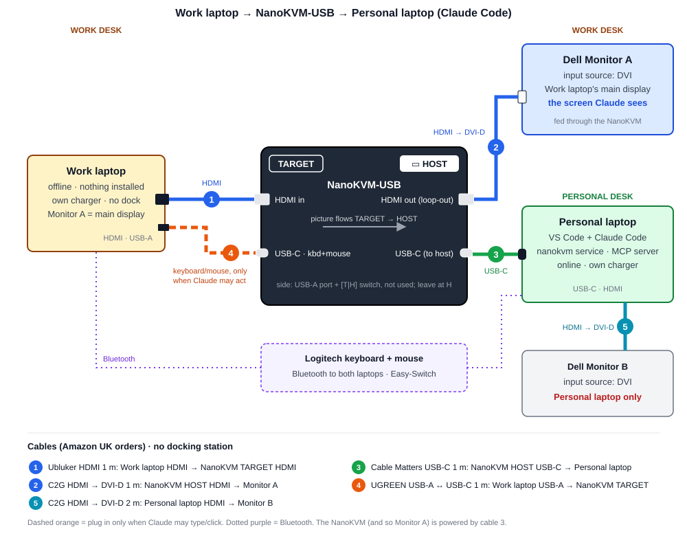

# AI help for a locked computer: Muse Glimmer and Muse Spark through a NanoKVM-USB

Some computers may not run AI software: a locked-down work laptop, a lab PC, a machine on a separate
network. With the approval of whoever owns such a computer and its data, this project gives it AI help
without installing anything on it and without getting around any of its controls. To that computer,
the Sipeed **NanoKVM-USB** is just a monitor and a USB keyboard and mouse; if a policy blocks new USB
keyboards, typing simply isn't available. The NanoKVM-USB sits between it, the **locked computer**, and a second
computer, the **AI computer**:

1. **Capture.** The NanoKVM-USB passes the locked computer's HDMI picture to the AI computer as a USB
   video device. Nothing is installed on the locked computer.
2. **Read locally.** Meta's open-weights **Muse Glimmer** runs on the AI computer's GPU (llama.cpp)
   and reads the screen: code with its line numbers, a description, or the error messages. In this
   pipeline, screen images never leave the AI computer.
3. **Redact.** Keys, tokens, passwords, email addresses, common hostnames and the terms you list are
   replaced with placeholders, Glimmer trims the text to what the question needs, and it is redacted
   again.
4. **Ask the cloud.** Only that redacted text goes to **Muse Spark** through Meta's Model API
   (`store: false`). Spark answers, or proposes code edits as function calls.
5. **Act, with your approval.** You approve each edit at the keyboard, or once per run with `--auto`. It is typed into VS Code on the
   locked computer through the NanoKVM-USB's keyboard, and Glimmer reads the screen again to check it.

**Not just code.** The aim is to help with whatever the locked computer shows: the errors and messages
of its software tools, often locked-down legacy tools nothing else can help with, as well as code.
Glimmer already reads all of these on the AI computer (`read --describe` names the application and
quotes its messages and errors). For now, `ask` and `edit` work from the code reading; asking Spark
about a tool's error dialog is next.

**Sensitive screens.** The locked computer may show patient records or company-confidential data. Its
screen images never leave the AI computer. Redaction catches values with a recognisable shape (keys,
tokens, passwords, email addresses, hostnames, card numbers, paths) and the terms you list, but it
can't reliably catch names, patient details or confidential prose. So when such data is on the
screen, send nothing: `nanokvm read` never sends, and `ask --local-only` (or `outbound = "local_only"`
in `nanokvm.toml`) has Glimmer answer on the AI computer instead of Spark. The assistant helps with the
software and its errors; it doesn't interpret patient data or give clinical advice.

**Status (29 Oct).** All five steps are built and pass their tests on a simulated locked computer, with
a fake Glimmer and a fake Meta API. With the real Glimmer and Spark, `read` and `ask` have run on
simulated screens. On the real hardware, capture and the live view work, and on 29 Oct Glimmer read
the real capture (a short C++ file transcribed exactly, the screen described correctly), and
`nanokvm fix --auto` found a deliberate syntax error by itself, typed its fix over cable 4 and checked
it on the screen. **The whole loop, step by step: [section 6a](#6a-the-whole-loop-step-by-step).**

**Hackathon entry.** This repo is my solo entry in the Meta Global AI Developer Hackathon (Indie
Developer track).

- **Built before the event** (7–25 Oct, git tag `pre-event-baseline`): the NanoKVM service (capture,
  keyboard and mouse), the `nanokvm` command's `diag`, `status`, `screenshot` and `watch`, the browser
  live view, the local Glimmer server setup (llama.cpp, the weights, `tools\run-glimmer.ps1` and the
  smoke tests), a smoke test for the Meta Model API, and a Claude Code bridge that isn't part of the
  entry.
- **Built during the event:** Glimmer reading and checking the screen (`glimmer.py`), redaction and
  the outbound gate, the Spark client, `nanokvm read`, `ask` and `edit`, and the viewer window.

[HACKATHON.md](HACKATHON.md) has the details. Demos use a stand-in PC showing dummy code, never a real
work computer.

---

## Contents

1. [How it works](#1-how-it-works)
   - [1a. Operating systems](#1a-operating-systems)
2. [What leaves the AI computer](#2-what-leaves-the-ai-computer)
3. [Wiring for this desk](#3-wiring-for-this-desk)
   - [3a. Parts list](#3a-parts-list)
4. [Locked computer settings](#4-locked-computer-settings)
5. [Install (already done)](#5-install-already-done)
   - [5a. Muse Glimmer on the AI computer's GPU (open weights)](#5a-muse-glimmer-on-the-ai-computers-gpu-open-weights)
   - [5b. Muse Spark through Meta's Model API](#5b-muse-spark-through-metas-model-api)
6. [Using it: read, ask and edit](#6-using-it-read-ask-and-edit)
   - [6a. The whole loop, step by step](#6a-the-whole-loop-step-by-step)
7. [Watching the screen yourself](#7-watching-the-screen-yourself)
8. [First run with the hardware](#8-first-run-with-the-hardware)
9. [Settings (nanokvm.toml)](#9-settings-nanokvmtoml)
10. [Safety details](#10-safety-details)
11. [Troubleshooting](#11-troubleshooting)
12. [Files and testing without hardware](#12-files-and-testing-without-hardware)
13. [Licence](#13-licence)

**Separate pages:** [What I built during the hackathon](HACKATHON.md) ·
[Hackathon plan (written before the event and on its first day; not kept up to date)](docs/hackathon-plan.md) ·
[Claude Code bridge (built before the event)](docs/claude-code.md)

---

## 1. How it works

```
locked computer ──HDMI──► NanoKVM-USB ──USB──► AI computer
                                                   │
 1. capture   nanokvm service                      │ the only program that opens the NanoKVM
 2. read      Muse Glimmer on the GPU              │ screen → text; images never leave
 3. redact    outbound gate                        │ placeholders, trimming, checks, audit log
 4. ask       Muse Spark (Meta Model API)          │ redacted text in; an answer or apply_edit calls out
 5. act       you approve; the NanoKVM types it    │ Glimmer checks the result on the screen (--auto: one yes a run)
locked computer ◄──USB keyboard── NanoKVM-USB ◄────┘
```

| Part | Runs on | Job |
|------|---------|-----|
| NanoKVM-USB | hardware | Gives the AI computer the locked computer's HDMI picture as a USB capture device (up to 1920x1080), and passes it through to Monitor A. With cable 4, it is also a USB keyboard and mouse for the locked computer. |
| `nanokvm` service | AI computer, in the background | The **only** program that opens the NanoKVM. It reads the video continuously (~30 fps), sends keystrokes, and serves a live view on `127.0.0.1`. It starts automatically and stops after 60 idle minutes (an open live view keeps it running). |
| Muse Glimmer | the AI computer's GPU, through llama.cpp's `llama-server` on `127.0.0.1:8001` | Reads the screen (code with line numbers, a description, or errors), trims text before it leaves, and checks typed edits on the screen. |
| Outbound gate | AI computer | The only path from screen text to Meta: redaction, trimming, a second redaction, checks and an audit log ([section 2](#2-what-leaves-the-ai-computer)). |
| Muse Spark | Meta's cloud, through the Model API | Answers questions about the screen and proposes edits with one tool, `apply_edit`. It only ever sees redacted text. |
| `nanokvm` command | AI computer | `read`, `ask` and `edit` ([section 6](#6-using-it-read-ask-and-edit)), the live `viewer` ([section 7](#7-watching-the-screen-yourself)) and `diag` ([section 8](#8-first-run-with-the-hardware)). |

Before the event, the same service was built as a bridge for Claude Code (an MCP server). It still
works and has its own page, [docs/claude-code.md](docs/claude-code.md); it isn't part of the entry.

### 1a. Operating systems

The two computers don't need the same operating system. To the locked computer, the NanoKVM is just
a monitor and a USB keyboard and mouse. To the AI computer, it's a USB video capture device (with an
audio device beside it for any HDMI sound, which the bridge never opens) and a USB serial port.

| Computer | Windows | macOS | Linux |
|----------|---------|-------|-------|
| Locked computer | Picture and Glimmer's reading tested (Windows 11); keyboard and mouse not yet | Should work; not tested | Should work; not tested |
| AI computer | Tested (Windows 11) | Not yet: needs porting | Not yet: needs porting |

**A locked computer on macOS or Linux.** Set `locked_os = "macos"` or `"linux"` in `nanokvm.toml`
([section 9](#9-settings-nanokvmtoml)). On a Mac, `nanokvm edit` then selects lines with Cmd+L instead
of Ctrl+L (Go to Line stays Ctrl+G). Also:

- `keyboard_layout` must match the layout chosen on that computer. `"uk"` and `"us"` are PC
  layouts, and Linux's English (UK) matches `"uk"`. A Mac's British layout puts some characters
  elsewhere, so on a Mac add the U.S. input source and set `"us"`.
- A Mac may open *Keyboard Setup Assistant* the first time it sees the NanoKVM's keyboard. If it
  asks for the keyboard type, choose ANSI, which matches `"us"`.
- [Section 4](#4-locked-computer-settings) uses Windows names. On macOS 13 or later, open *System
  Settings > Displays*, select Monitor A and set *Use as* to *Main display*; on macOS 12 or earlier,
  drag the white menu bar onto Monitor A in *System Preferences > Displays > Arrangement*. On Linux
  the NanoKVM's mouse may span every display that is on (it does on X11), so keep Monitor A the only
  display (GNOME: *Settings > Displays*). This is untested.
- Section 4's VS Code shortcuts are the Windows and Linux ones. On a Mac they use Cmd (Cmd+Shift+P,
  Cmd+B, Cmd+J), except Go to Line, which stays Ctrl+G.

**The AI computer must run Windows for now:** capture uses DirectShow, so on macOS or Linux it stops
with *video capture needs Windows on the AI computer*, and the Glimmer launcher is a PowerShell script
for the Windows CUDA build of llama.cpp. Running it elsewhere is future work
([hackathon plan, section 8](docs/hackathon-plan.md#8-open-questions-and-risks)).

## 2. What leaves the AI computer

| What | Where it goes |
|------|---------------|
| The screen picture | **Nowhere**, with `read`, `ask` and `edit`: Muse Glimmer reads it on the AI computer's GPU. The pipeline never writes a frame to disk: each frame is dropped as soon as Glimmer has read it, the service zeroes its pixel copies, Glimmer's thinking text is discarded, and its server is flushed after every image. |
| Redacted text | To Muse Spark through Meta's Model API, only through the outbound gate below. |
| Spark's answer and edits | Back to the AI computer, where placeholders are restored. Edits are typed only after you approve them: each one, or a whole run's once with `--auto` ([section 6](#6-using-it-read-ask-and-edit)). |
| A record of both | `.run\outbound.log` on the AI computer: exactly what was sent and received. It holds redacted screen text, so treat it as sensitive. |
| Screenshots, with the Claude Code bridge | To Anthropic, but only once you approve sharing in a Claude Code conversation. The bridge was built before the event and isn't part of the entry ([docs/claude-code.md, section 3](docs/claude-code.md#3-approvals-and-what-goes-to-anthropic)). Don't share a real locked computer with it unless its owner has approved Anthropic too. |

**The outbound gate** (`src\nanokvm_mcp\outbound.py`) is the only path from screen text to Meta:

1. **Redaction** replaces private keys, API keys (AWS, GitHub, Slack, Google, Meta, `sk-…`), JWTs,
   passwords and secrets in `key = value` form, URLs, email addresses, network (UNC) paths, user names
   in `C:\Users\…` and `/home/…` paths, IP and MAC addresses, card numbers (Luhn-checked), long random
   tokens, and lower-case hostnames ending in `.com`, `.org`, `.gov`, `.edu`, `.mil`, `.local`,
   `.corp`, `.internal`, `.intranet`, `.lan` or a `.uk` domain, with placeholders such as
   `[[EMAIL_1]]`, plus any terms you list in `.run\redact_terms.txt`. The patterns are narrow, so
   ordinary code survives (`std::vector<int>`, `a->b`, `0x2A`). Names, project code words and other
   hostnames or machine names look like ordinary text: list them in `.run\redact_terms.txt`. Patient
   details (names, NHS numbers, dates of birth, addresses, clinical notes) and confidential prose
   aren't caught by the patterns, so when they are on the screen, use `local_only` and send nothing (see
   *Sensitive screens* at the top of this page).
2. **Trimming.** Glimmer copies out only the lines the question needs. The excerpt is rebuilt from the
   redacted lines themselves, so it can only contain text that was on the screen. `fix` has no question,
   so it sends every code line on the screen, plus Glimmer's notes about the screen in a separate
   `<screen_notes>` block, redacted the same way; Spark is told both are data, not instructions.
3. **A second redaction pass**, with the same placeholders.
4. **Checks**, any of which stops the send: `outbound = "local_only"`; free credits (below); a redacted
   value still present; an inline image (`data:image`); more than `outbound_max_chars`; the logged spend
   reaching `meta_budget_usd`; `.run\outbound.halt` (written when a reply came from an unexpected
   model); and, with `outbound = "approve"`, you declining after seeing the exact text.
5. **Sending.** The exact text is logged, then sent with `store: false` to a Standard model
   (`muse-spark-1.3`; `-contributor` models are refused). The reply must name exactly that model;
   a reply from any other model is discarded and sending halts.

For `nanokvm edit`, each later request in the conversation passes the same checks. What is sent back
to Spark about an edit is in words and line numbers only, never screen text.

**Modes** (`outbound`): `auto` sends after redaction (the default); `approve` shows you the exact text
and asks first; `local_only` sends nothing, and `nanokvm ask` then answers with Glimmer alone.

**Free credits.** Meta's Billing page says content sent on free credits "may be used for product
improvement". While `meta_billing = "free_credits"`, only stand-in or dummy content may be sent
(`--stand-in`). For real content, switch Billing to pay as you go and set `meta_billing = "paid"`.

**What goes into the locked computer:** no network, no software, no drivers. HDMI carries the picture
*out*; the only thing that goes back is the monitor identification (EDID) every monitor sends.
Cable 4 carries only keyboard and mouse input; the NanoKVM can send keystrokes but never read them.
`nanokvm edit` and `fix` type only edits you approve at their prompt (each one, or once per run with
`--auto`). The service itself accepts keystrokes from
any program that can read `.run\token` ([section 10](#10-safety-details)), including the Claude Code
bridge, which asks you in Claude Code before each action.
**Physical switches:** unplug cable 4 and nothing can be typed; unplug cable 3 and the AI computer can
neither see nor type (Monitor A goes dark too). Only Monitor A, the screen wired through the NanoKVM,
is ever captured.

Use this only with the approval of whoever owns the locked computer and its data, for example your
employer or client.

## 3. Wiring for this desk



The diagram is `docs\wiring.svg`. Press **Ctrl+Shift+V** in VS Code to see it here.

**Know the NanoKVM-USB's ports.** Your unit is a small black box with **"TARGET"** printed at one
end of the top and **"HOST"**, with a laptop icon, at the other. **Each end has one full-size HDMI
port and one USB-C port.** The icons on the side show that the picture flows from the TARGET end
to the HOST end:

```
                 top:  [ TARGET ]             NanoKVM USB              [ 💻 HOST ]
                ┌─────────────────────────────────────────────────────────────────┐
  TARGET end ───┤ HDMI  (icon: monitor →)  = video IN   ◄── cable 1               │
                │ USB-C (icon: keyboard+mouse) = to locked computer ── cable 4    │
                │                                                                 ├─── HOST end
                │      HDMI  (icon: monitor →) = video OUT (loop-out) ─────────────► cable 2
                │      USB-C (icon: monitor+keyboard+mouse) = to AI computer ──────► cable 3
                └────────────── side: USB-A port + [ T | H ] switch ──────────────┘
```

| End | Port | Side icon | Cable | Goes to |
|-----|------|-----------|-------|---------|
| **TARGET** | HDMI | monitor → | **1** (HDMI) | Locked computer's HDMI port. This is the video **input**. |
| **TARGET** | USB-C | keyboard + mouse | **4** (USB-C → USB-A) | Locked computer's USB-A port, so it sees a keyboard and mouse |
| **HOST** | HDMI | monitor → | **2** (HDMI → DVI-D) | Dell Monitor A's white DVI port. This is the video **output** (loop-out). |
| **HOST** | USB-C | monitor + keyboard + mouse | **3** (USB-C → USB-C) | AI computer. It carries the video and keyboard/mouse data, and powers the NanoKVM. |
| side | USB-A + T/H switch | – | none | Not used. Leave the switch at **H** (as shipped): a USB stick in this port would then only reach the AI computer, never the locked computer. |

> ⚠️ The most likely mistake is plugging the locked computer's HDMI into the **HOST** end. That port
> is an output, so you'd get no picture anywhere. The locked computer always connects to the
> **TARGET** end.

**The complete wiring (two desks; no docking station at the locked computer):**

```
LOCKED COMPUTER DESK
[1] locked computer HDMI port ── HDMI ────────────► NanoKVM TARGET HDMI
[4] locked computer USB-A port ─ USB-A → USB-C ───► NanoKVM TARGET USB-C   (only when edits may be typed)
[2] NanoKVM HOST HDMI ────────── HDMI → DVI-D ────► Dell Monitor A, white DVI port

AI COMPUTER DESK
[3] NanoKVM HOST USB-C ───────── USB-C → USB-C ───► AI computer USB-C
[5] AI computer other USB-C ──── USB-C dock ── DisplayPort ──► Dell Monitor B, DisplayPort input

Logitech keyboard + mouse: Bluetooth to both laptops; Easy-Switch between them.
Each laptop on its own charger.
```

Setup steps:

1. **Disconnect the locked computer from its docking station** and both monitors, and plug each
   laptop into its own charger.
2. Connect cables **1, 2 and 3**, and connect Monitor B through the USB-C dock (**5**). Connect cable
   **4** only when edits may be typed.
3. Use the monitors' buttons to set **Monitor A's input source to DVI** and **Monitor B's to
   DisplayPort**.
4. On the locked computer, make **Monitor A the main display** ([section 4](#4-locked-computer-settings)).
5. On the AI computer, set Armoury Crate's **GPU Mode to Standard**. Then `nvidia-smi
   --query-gpu=display_active --format=csv` says *Disabled*: no display uses the NVIDIA GPU, and
   Muse Glimmer has all of its memory ([section 11](#11-troubleshooting), *VS Code or the desktop stalls*).

Notes:

- **Why DVI for Monitor A.** The Dell monitors have DisplayPort, DVI-D and VGA inputs, but no HDMI.
  HDMI and DVI-D carry the same digital picture, so a passive HDMI-to-DVI-D cable needs no power or
  converter. Don't use VGA: it's analogue and blurry.
- **Why Monitor B goes through a dock.** The dock (a StarTech.com 116N-USBC-DOCK, which uses
  DisplayLink) keeps Monitor B off the NVIDIA GPU. A display on that GPU takes some of the memory
  Glimmer needs, and the desktop then stalls while Glimmer runs.
- **Monitor A depends on the AI computer.** The NanoKVM is powered through cable 3. If the
  AI computer is off or cable 3 is unplugged, Monitor A goes dark. To use the locked computer
  alone, unplug cable 1 and plug cable 2's HDMI end straight into the locked computer's HDMI port.
- **Why cable 4 is USB-A at the laptop end.** Some users found that USB-C to USB-C on the
  NanoKVM's TARGET side doesn't work.
- **Keyboard and mouse.** Use the Logitech **Easy-Switch** buttons to change laptops. Logitech
  *Flow* would need Logitech software and a network connection on the locked computer, so don't use
  it.
- **The NanoKVM's side USB-A port and T/H switch** are for a USB stick and aren't needed. Leave
  the switch at **H**, so nothing plugged in there can reach the locked computer. The switch doesn't
  affect video, capture or keyboard/mouse.

### 3a. Parts list

The NanoKVM-USB came with **no cables**. Ordered on Amazon UK on 2026-10-07:

| # | Ordered | Connects |
|---|---------|----------|
| 1 | Ubluker HDMI cable (48 Gbps), 1 m | Locked computer HDMI → NanoKVM TARGET HDMI |
| 2 | [C2G HDMI to DVI-D cable](https://www.amazon.co.uk/C2G-Digital-Suitable-Raspberry-Stations/dp/B00CQSYS48), 1 m | NanoKVM HOST HDMI → Dell Monitor A DVI |
| 3 | [Cable Matters USB-IF certified USB-C to USB-C, 10 Gbps](https://www.amazon.co.uk/USB-IF-Certified-Cable-Matters-Delivery/dp/B01L0F6AJI), 1 m | NanoKVM HOST USB-C → AI computer. Must be a USB 3 data cable: it carries the video and powers the NanoKVM. |
| 4 | [UGREEN USB-A to USB-C, USB 3.0](https://www.amazon.co.uk/dp/B08XJP9GMP), 1 m | Locked computer USB-A → NanoKVM TARGET USB-C (keyboard/mouse) |
| 5 | StarTech.com 116N-USBC-DOCK and a DisplayPort cable (not part of the 7 Oct order) | AI computer USB-C → dock → Dell Monitor B DisplayPort. On 29 Oct it replaced the 2 m C2G HDMI-to-DVI-D cable ordered for Monitor B. |

## 4. Locked computer settings

**Display** (*Settings > System > Display* on Windows 11; for macOS and Linux see
[section 1a](#1a-operating-systems)):

- Use **Extend** mode: the laptop's own screen + Monitor A.
- **Monitor A must be the main display.** Select Monitor A and tick *Make this my main display*.
  Work you want help with goes on Monitor A, the only screen that is captured, and the NanoKVM's
  mouse always targets the main display.
- Set Monitor A to its **native resolution at 60 Hz**. The NanoKVM accepts up to 4K at 30 Hz and
  delivers 1920x1080 to the AI computer, so a 1920x1080 monitor gives Glimmer the sharpest picture.
- If Monitor A is **1920x1200** (16:10), the picture is squashed. Add `display_aspect = "16:10"` to
  `nanokvm.toml`.

**Keyboard layout.** Edits are typed for the layout in `nanokvm.toml`, currently
`keyboard_layout = "uk"`. It must match the locked computer's keyboard layout, assumed to be English
(UK) but not yet checked: see the input indicator on its taskbar, or *Settings > Time & language >
Language & region*. If that laptop uses US, set `"us"`. If the locked computer isn't Windows, set
`locked_os` too ([section 1a](#1a-operating-systems)).

**Sleep.** A sleeping laptop sends no picture. Wake it before you run a command.

**VS Code for reading code.** Code is small, thin, coloured text, which is the hardest thing for a
video capture. These are only VS Code settings; nothing is installed. Open *Ctrl+Shift+P > Preferences:
Open User Settings (JSON)* and add:

```jsonc
"editor.fontSize": 16,                // default 14; 16 stays legible in the capture
"editor.minimap.enabled": false,      // more width for code
"editor.wordWrap": "on",              // no code hidden off the right edge
"editor.stickyScroll.enabled": true   // the current class/function name stays visible at the top
```

- **Maximise VS Code on Monitor A,** running at **1920x1080**. While Glimmer reads, hide the side
  bar (**Ctrl+B**) and the panel (**Ctrl+J**). That gives about 40–45 lines per screen.
- **Keep line numbers and the status bar on** (the defaults). Glimmer reads the line numbers, and
  `nanokvm edit` checks the cursor position ("Ln 23, Col 1") on the status bar.
- **Theme is optional.** A light theme (*Light Modern*) survives video compression best. Dark
  themes work, but thin coloured text is slightly softer.

**VS Code for typed edits (cable 4).** VS Code's typing helpers would garble code typed key by key:
they close brackets, quotes, `/*` comments and HTML or JSX tags, add indentation, wrap a selection
instead of replacing it, generate Doxygen comments, and let Enter, Tab or punctuation accept a
suggestion. Before you run
`nanokvm edit` or `fix`, switch them off in the same settings file, and keep VS Code from saving or
reformatting by itself (`files.autoSave` off, `editor.formatOnSave` false): nanokvm never saves, so
nothing it types is saved until you have looked at it. The C/C++ extension's own `[cpp]` defaults
win over global settings, so the main ones are repeated in a `[cpp]` block. (These were checked
against VS Code 1.144's source on 29 Oct.)

```jsonc
"editor.autoClosingBrackets": "never",
"editor.autoClosingQuotes": "never",
"editor.autoClosingComments": "never",
"editor.autoSurround": "never",
"editor.autoIndent": "none",
"editor.formatOnType": false,
"editor.trimAutoWhitespace": false,
"editor.acceptSuggestionOnEnter": "off",
"editor.acceptSuggestionOnCommitCharacter": false,
"editor.quickSuggestions": { "other": "off", "comments": "off", "strings": "off" },
"editor.suggestOnTriggerCharacters": false,
"editor.inlineSuggest.enabled": false,
"editor.wordBasedSuggestions": "off",
"editor.unusualLineTerminators": "off",
"editor.folding": false,
"html.autoClosingTags": false,
"javascript.autoClosingTags": false,
"typescript.autoClosingTags": false,
"C_Cpp.doxygen.generateOnType": false,
"files.autoSave": "off",
"editor.formatOnSave": false,
"[cpp]": {
  "editor.autoClosingBrackets": "never",
  "editor.autoClosingQuotes": "never",
  "editor.autoClosingComments": "never",
  "editor.autoSurround": "never",
  "editor.autoIndent": "none",
  "editor.formatOnType": false,
  "editor.acceptSuggestionOnEnter": "off",
  "editor.acceptSuggestionOnCommitCharacter": false,
  "editor.quickSuggestions": { "other": "off", "comments": "off", "strings": "off" },
  "editor.suggestOnTriggerCharacters": false
}
```

One helper has no setting: a line that starts with `}`, `)` or `]` is re-indented to match the line
that opened it. For well-indented code that is what gets typed anyway, and the check after typing
catches any difference.

## 5. Install (already done)

Everything lives in `E:\meta_hackathon`. Nothing was installed globally, and the existing conda
environments were not used. One change outside this folder: on 25 Oct, `llama-server.exe`,
`python.exe` and `pythonw.exe` were excluded from Windows Error Reporting (each a DWORD set to 1
under `HKCU\Software\Microsoft\Windows\Windows Error Reporting\ExcludedApplications`, for this user
only), so Windows doesn't collect a crash report that could hold screen text from their memory.
Delete those three values to undo it.

| What | Location |
|------|----------|
| Python 3.12 (uv-managed) | `.uv\python\cpython-3.12.14-windows-x86_64-none\` |
| uv download/build cache | `.uv\cache\` (set in `uv.toml`) |
| Virtual environment and packages (`opencv-python-headless`, `pyserial`, `numpy`, `mcp`, …) | `.venv\` |
| This project's code / tests | `src\nanokvm_mcp\` / `tests\` |
| Settings | `nanokvm.toml` |
| Runtime files (token, keys, logs, calibration) | `.run\` |
| Claude Code bridge registration and permissions (this folder only) | `.mcp.json`, `.claude\settings.local.json` |

**The serial driver.** The NanoKVM's keyboard/mouse channel is a WCH CH343 USB-serial chip
(`1A86:55D3`). When it was first plugged in (22 Oct), Windows used the WCH driver already on this
laptop, so nothing was installed for it. Like any driver, it lives in Windows, not in this folder.
Video works without it.

To rebuild the environment from scratch, run this in PowerShell in this folder. It uses `uv`, which
isn't in this folder: it's the copy already installed in `%USERPROFILE%\.local\bin` (uv 0.12.5
built the current `.venv`).

```powershell
$env:UV_PYTHON_INSTALL_DIR = "E:\meta_hackathon\.uv\python"
uv python install 3.12.14 --no-bin --no-registry
uv venv .venv --python "E:\meta_hackathon\.uv\python\cpython-3.12.14-windows-x86_64-none\python.exe"
uv sync
```

`E:` is formatted exFAT, which has no symlinks or hardlinks. That's why `uv.toml` sets
`link-mode = "copy"`. During `uv python install`, the message *"Failed to create Python minor
version link directory"* is harmless.

### 5a. Muse Glimmer on the AI computer's GPU (open weights)

Meta's open-weights **Muse Glimmer** (30B, Apache-2.0) runs on the AI computer's own GPU, an RTX 5090
Laptop GPU with 24 GB, through llama.cpp. Glimmer isn't a hosted model, and no screen image goes
anywhere else: the server listens only on `127.0.0.1` and needs the key in `.run\llama_api_key`. This
server setup was done before the event (24 Oct); the code that uses it (`glimmer.py` and the pipeline)
was written during it. The weights and llama.cpp aren't in the repo (they're git-ignored); these are
their sources:

| What | Source | Details |
|------|--------|---------|
| llama.cpp | [release b10976](https://github.com/ggml-org/llama.cpp/releases/tag/b10976): `llama-b10976-bin-win-cuda-13.3-x64.zip` and `cudart-llama-bin-win-cuda-13.3-x64.zip`, kept in `tools\downloads\` | build 10976 (commit `987498f45`), Windows CUDA 13.3 build, unzipped into `tools\llama.cpp\` |
| Weights | Unsloth's [unsloth/Muse-Glimmer-30B-GGUF](https://huggingface.co/unsloth/Muse-Glimmer-30B-GGUF) | `models\unsloth\Muse-Glimmer-30B-UD-Q4_K_XL.gguf`, 15,878,222,368 bytes, SHA-256 `82bece304887a313ece08400bc030f6066c7bff5b906b0cd40308ec8a409fd38` |
| Vision projector | the same Unsloth repo | `models\unsloth\mmproj-Muse-Glimmer-30B-BF16.gguf`, 3,849,173,728 bytes, SHA-256 `d08cdcfa0b41d8e20554b52df404ba4f7b440d0bc502a90038508b6407df8ee1` |
| DFlash drafter (speeds up generation) | Meta's [meta-models/Muse-Glimmer-30B-GGUF](https://huggingface.co/meta-models/Muse-Glimmer-30B-GGUF) | `models\dflash-Muse-Glimmer-30B-Q4_K_M.gguf`, 1,631,208,128 bytes, SHA-256 `b2e808bf656086fe86bd0d0bd990f01d33e377537a07c02d45371517c8b264ef` |
| Launcher | this repo | `tools\run-glimmer.ps1`: one slot, 32K context, all layers on the GPU, images up to 4,096 tokens, DFlash at draft length 15, no web UI, no prompt logging (but an answer that fails to parse is printed in its window, so treat that window like a reading) |
| NVIDIA's compiled-kernel cache | made on first run | `.cache\nv\` |

Start the server, then check it from a second terminal:

```powershell
# Terminal 1: llama-server on http://127.0.0.1:8001 only; Ctrl+C stops it
E:\meta_hackathon\tools\run-glimmer.ps1
# Terminal 2: waits for the server, has Glimmer read a dummy C++ screen, prints accuracy, speed and GPU memory
E:\meta_hackathon\.venv\Scripts\python.exe E:\meta_hackathon\tools\glimmer_smoke.py
```

**Measured on this laptop (24 Oct, before the event, with `tools\glimmer_smoke.py` on dummy C++
rendered at 1920x1080):** all 27 of 27 lines right (compared with runs of spaces collapsed, so
indentation wasn't checked), and a full-screen read in 6.7–7.0 s (image prompt about 5 s, generation 131–141 tokens/s), using
about 23 GB of the GPU's 24 GB with the drafter on. To check the files yourself, run `Get-FileHash` on them and compare the SHA-256
values above. Glimmer is fast only in Turbo mode on the 240 W barrel charger; see *Glimmer is slow*
in [section 11](#11-troubleshooting). It also needs the NVIDIA GPU to itself, with no display on it
([section 3](#3-wiring-for-this-desk), setup step 5). More measurements are in
[the hackathon plan, section 7](docs/hackathon-plan.md#7-schedule-and-status).

**On the real capture (29 Oct, during the event, without the drafter, 20.9 GB of GPU memory):** a
9-line C++ file in VS Code on the locked computer was transcribed exactly (checked by eye against the
screen) in 7.1 s, and `read --describe` named the app, the file and the status bar's contents
correctly in 13.5 s, each from a 1920x1080 frame of 2,691 image tokens. **With the drafter on** (21.7 GB,
with the NVIDIA GPU driving no display), the same two reads took **6.1 s and 6.7 s**, with the same
transcription and an equally correct description.

### 5b. Muse Spark through Meta's Model API

Muse Spark runs in Meta's cloud. Save your Model API key as the only line of `.run\meta_api_key`
(git-ignored; it is never printed or logged), then check the account with dummy text:

```powershell
E:\meta_hackathon\.venv\Scripts\python.exe E:\meta_hackathon\tools\spark_smoke.py
```

It lists the models the key can use, sends three dummy chat requests with `store: false` (plain,
strict JSON and streaming), and checks that each reply came from exactly `muse-spark-1.3`. This smoke
test was written before the event. The client the pipeline uses (`src\nanokvm_mcp\spark.py`, written
during it) uses Chat Completions with streaming, refuses redirects, sends text only, and accepts only
Standard model IDs.

## 6. Using it: read, ask and edit

Start Muse Glimmer first, in its own terminal: `E:\meta_hackathon\tools\run-glimmer.ps1`
([section 5a](#5a-muse-glimmer-on-the-ai-computers-gpu-open-weights)), after checking that no display
uses the NVIDIA GPU ([section 3](#3-wiring-for-this-desk), setup step 5). It refuses to start while
another llama-server runs or port 8001 is taken: two servers could share the port, and requests would
go to either. Then, in another terminal
(prefix each command with `E:\meta_hackathon\.venv\Scripts\`):

```powershell
nanokvm read                                   # transcribe the code on the screen, with line numbers
nanokvm read --describe                        # describe what is on the screen
nanokvm read --errors                          # list the compiler errors and warnings on the screen
nanokvm ask "why does sum_first overrun?"      # Spark answers from the redacted screen text
nanokvm edit "fix the off-by-one in sum_first" # Spark proposes edits; each one you approve is typed in
nanokvm fix                                    # no request: Spark finds the error on the screen and fixes it
```

Each command first checks that Glimmer answers (if it doesn't, nothing is shared), then asks you, at the
keyboard, to share the screen with Muse Glimmer for a few minutes (`--minutes`: 5 by default, 10 for
`edit`; the share ends as soon as the command does). There is deliberately no `--yes`, and nothing is approved
without a terminal, so a script, or an AI running commands without one (such as Claude Code's shell
tool), can't approve. This guards against mistakes, not against programs on this computer: anything
that can type into the terminal running `nanokvm` can answer its prompts, and a program that can read
`.run\token` can use the service without the command ([section 10](#10-safety-details)). So don't let
an AI drive that terminal. `--region x,y,w,h` reads only part of the screen (in the pixels of a
`nanokvm screenshot`).

- **`read`** keeps everything on the AI computer. It prints the text and how long Glimmer took, and a
  warning if the picture was uniform (no signal, a sleeping display); for code, it also says which line
  numbers it read and whether any are missing (numbers only). Like `ask` and `edit`, it refuses a frame
  more than 2 s old: when the video stops, the service's last frame may show what is no longer there.
- **`ask`** reads, sends only the redacted, trimmed text to Spark, and prints its answer with the
  placeholders restored. It also says what was redacted, whether Glimmer trimmed the text, what the
  request cost and where it is logged. `--stand-in` marks the screen as dummy content (required while
  Meta billing is on free credits), `--approve` shows the exact text before sending (it can only make
  `outbound` stricter, never looser), and `--local-only` has Glimmer answer instead, sending nothing.
- **`edit`** works like `ask`, but Spark answers with `apply_edit` calls: replace lines S to E with new
  lines. `--stand-in` and `--approve` work as for `ask`.
- **`fix`** is `edit` with no request. Glimmer also notes what is wrong in the VS Code window (the file's
  name only, squiggles, its Problems and terminal panels, the status bar's counts; never other apps or
  the system's notifications), shows you those notes, and Spark gets a built-in instruction, the notes
  and every code line on the screen, untrimmed, so it can find the error itself. After each typed
  edit, Spark also gets the screen as Glimmer read it to check that edit, so its next step starts from
  the screen as it is now. When Spark says it's done, Glimmer reads the screen afresh (the code and its
  notes again) and Spark checks every line for anything the edits broke; if something is still wrong it
  carries on editing. That final check happens at most twice, within the limits below.
- **`--auto`** (for `edit` and `fix`) types Spark's edits without asking for each one. You allow it once
  per run, at the keyboard: the share prompt then asks to share the screen *and* to type without
  asking. Each edit is still shown, the screen is checked before and after typing, the first failed
  check stops the run, Ctrl+C stops it at once, and nothing is saved: review the changes before you save
  (Ctrl+Z or *File: Revert File* undoes them). Meta's usage policy asks for authorization, oversight,
  review and confirmation before consequential actions; the once-per-run yes, the checks and leaving the
  saving to you are how this mode provides them. Check that the locked computer's owner is happy with
  edits typed this way. While Meta billing is on free credits, `--stand-in` is still needed to send.

**Checking what Glimmer reads.** To measure its accuracy on the live screen, show the dummy file
`tools\ab_screens\live_check.cpp` (10 lines) in VS Code on the locked computer. Typed by hand, it must
match the file exactly, so first add `"editor.autoClosingBrackets": "never"`, `"editor.autoIndent":
"none"`, `"editor.acceptSuggestionOnEnter": "off"` and `"editor.inlineSuggest.enabled": false` to the
user settings (all the typed-edit settings in [section 4](#4-locked-computer-settings) work too). Open a
new empty window (Ctrl+Shift+N) so no work is on the screen, press Ctrl+N, choose Plain Text (Ctrl+K M)
so VS Code can't switch the tab to C++ while you type, and type the file, making the spaces with the
space bar and pressing no Enter after the last `}`. Press End, then Home, on each line: the status bar
should show *Col 5* on lines 5, 6, 8 and 9, *Col 9* on line 7 and *Col 1* on the others (Home alone
jumps to column 1 when the cursor is already at the indent). Then set the language to C++ (Ctrl+K M), so
it is coloured like real code (the text doesn't change), and run
`nanokvm read --check tools\ab_screens\live_check.cpp` (it finds the file from any folder). It lists by
line number which lines Glimmer read exactly, which differ only in spaces, indentation or text, and
which it missed. It never repeats the text read, so those lines can be shared; the transcription
printed above them can't.

**How `nanokvm edit` types an edit.** For each `apply_edit` call:

1. **Checks on the AI computer.** Placeholders are restored; no placeholder or tab may be left; every
   character must be typeable on the keyboard layout; at most 40 lines and 2,000 characters per edit;
   and the lines must be on the screen and read unambiguously. Lines whose numbering looks wrong (a
   wrapped row read as a new line, a sticky-scroll header, a number read twice) are left out, and so
   is the last line shown, whose wrapped rows may go on below the screen. Only the first edit in each
   reply from Spark is used.
2. **Your approval.** It shows the change as a diff with the file's line numbers, the exact keys it
   will press and Spark's note, then asks *Type this edit? [y/N]*.
3. **Typing, keyboard only.** Escape, then Ctrl+G. Glimmer checks that VS Code's Go to Line box opened
   (by the `:` some versions type into it, or by its hint about a line number) before anything else is
   typed: elsewhere, digits and Enter could act (in VS Code's terminal,
   Ctrl+G is *Go to Recent Directory*, and Enter would run a `cd`). Then the line number and Enter go to
   the line. Glimmer reads the status bar (it must say *Ln S, Col 1*, with nothing selected) and the
   lines there (they must be the ones Spark changed). Ctrl+L once per line selects them, checked on
   the status bar again (the selection must end at column 1 of the next line), Backspace deletes
   them, and the new lines are typed.
4. **The result is checked.** Glimmer reads the screen again: the new lines must be there, followed by
   the line that came after the old ones. Each line must have the same indentation; runs of spaces
   inside a line aren't compared, since Glimmer can't count them reliably.

If an edit fails step 1, or you decline it, nothing is typed: Spark is told why, in words and line
numbers, and may propose another. A failed check in step 3 or 4 stops the session and nothing more is
typed. Before Backspace, only navigation keys have been sent and the file is unchanged; after it,
check the file. At most 4 edits and 6 requests to Spark per session. **Ctrl+C** in the terminal stops
the typing within about a quarter of a second and releases every key.

Before running `edit`: plug in cable 4, show the file in VS Code on the locked computer in a single
editor group (no split editor or diff view) with its editor focused, switch the typing helpers off
([section 4](#4-locked-computer-settings)), and **save the file**. Undoing typed code takes many
Ctrl+Z presses (VS Code undoes it in small steps), while *File: Revert File* returns to the saved
version at once. Typing runs at about 20 characters a second, so ask for small, targeted edits. While
it types, leave the locked computer's own keyboard and mouse alone: Windows shares Shift, Ctrl and Alt
between keyboards, and a click moves the focus. Keep Caps Lock off too; it is shared as well, and
typing allows for it only when the NanoKVM reports it.

### 6a. The whole loop, step by step

This is how `nanokvm fix --auto` found and fixed a deliberate syntax error on the real locked computer
on 29 Oct: Muse Glimmer reads and diagnoses the screen on the AI computer's GPU, Muse Spark gets only
redacted text and proposes an edit, the NanoKVM-USB types it, Glimmer checks the result, and Spark
looks at the screen again until the problem is fixed.

**On the AI computer, once per session**

1. **Power and GPU.** Plug in the 240 W barrel charger, choose Armoury Crate's **Turbo** mode (Fn+F5)
   and **GPU Mode Standard**, and keep any external monitor off the NVIDIA GPU
   ([section 3](#3-wiring-for-this-desk), setup step 5). Check:
   `nvidia-smi --query-gpu=display_active --format=csv` says *Disabled*.
2. **Keep the readings private.** Close other apps that can capture this screen (other AI assistants,
   screen recorders), and run the commands below in PowerShell windows outside VS Code: the readings
   print there.
3. **Load Muse Glimmer on the GPU** in window 1, and keep that window open:

   ```powershell
   powershell -NoProfile -ExecutionPolicy Bypass -File E:\meta_hackathon\tools\run-glimmer.ps1
   ```

   It is ready when it shows `model loaded` and `listening on http://127.0.0.1:8001` (about 10–30 s
   with the files cached, about 72 s from cold); `nvidia-smi` then shows `llama-server.exe` using about
   21.7 GB. The launcher refuses to start a second server. `-NoDFlash` leaves out the drafter (2.4 GB
   less, but slower long answers: [section 5a](#5a-muse-glimmer-on-the-ai-computers-gpu-open-weights)).
4. **Start the NanoKVM service** in window 2:

   ```powershell
   E:\meta_hackathon\.venv\Scripts\nanokvm.exe start
   ```

   The service opens the NanoKVM's capture device and hands frames to Glimmer only during a share that
   you approve; it saves no picture. A few seconds later `nanokvm status` shows
   `Video: streaming 1920x1080 MJPG ... 30 fps` and `Sharing: 0 ...`. With cable 4 plugged in,
   `nanokvm keytest` checks that the locked computer takes the NanoKVM's keys (it presses Num Lock
   twice and takes no picture).

**On the locked computer**

5. Show the file in VS Code in one editor group, with the typing helpers and auto-save off
   ([section 4](#4-locked-computer-settings)), and save it. Turn on Do not disturb and keep Caps Lock
   off; `keyboard_layout` in `nanokvm.toml` must match its keyboard layout. Click into the file so VS
   Code has the focus, then leave the locked computer's keyboard and mouse alone.

**Read, then fix** (in window 2; type `y` at the share prompt)

6. **See what Glimmer reads:** `nanokvm read` transcribes the code with its line numbers, and
   `nanokvm read --describe` describes the screen. Neither sends anything.
7. **Let Spark fix it:**

   ```powershell
   E:\meta_hackathon\.venv\Scripts\nanokvm.exe fix --stand-in --auto   # dummy content, Meta billing on free credits
   E:\meta_hackathon\.venv\Scripts\nanokvm.exe fix --auto              # real work: pay as you go and meta_billing = "paid"
   ```

   One `y` shares the screen and lets the edits be typed without asking for each one. Then, on its own:
   Glimmer reads and diagnoses the screen → Spark proposes an edit → the NanoKVM types it, with
   Glimmer checking the screen before and after → Spark sees the screen as it now is → when Spark says
   it's done, Glimmer reads the screen afresh and Spark checks the fix there. It stops when the fix is
   confirmed, at the first failed check, or at the limits (4 edits, 6 requests to Spark); Ctrl+C stops
   it at once. Leave out `--auto` to approve each edit, or use `nanokvm edit "REQUEST"` to ask for a
   particular change. With patient or confidential data on the screen, don't use `fix`: it sends
   redacted text, and redaction can't catch those (*Sensitive screens* at the top of this page).
8. **Review, then save.** nanokvm never saves: look at the change in VS Code, then save it, or undo it
   with Ctrl+Z or *File: Revert File*.
9. **Finish:** Ctrl+C in window 1 stops Glimmer, and `nanokvm stop` stops the service.

## 7. Watching the screen yourself

### In a window on the AI computer

Run `E:\meta_hackathon\.venv\Scripts\nanokvm.exe viewer`. A window on the AI computer shows the
locked computer's screen live, at up to 30 fps (`--fps` changes it). Two status lines under the
picture show:

- the capture mode, the capture and window frame rates, and the delay from capture to the window;
- *shown at 75%* (for example) when the picture is scaled down to fit the window: press **1** for
  actual pixels, so small text is as sharp as the capture;
- a warning if the picture is uniform (no HDMI signal, a sleeping display or a blank screen);
- the keyboard/mouse COM port and, once a keyboard/mouse action has opened the link, whether the
  NanoKVM reports cable 4 as connected;
- whether `nanokvm read`, `ask` or `edit` is reading the screen with Muse Glimmer, and whether a
  Claude conversation is sharing it ([docs/claude-code.md](docs/claude-code.md)).

The window is read-only: keys and clicks in it stay on the AI computer, it never makes the service
open the keyboard/mouse link, and it saves nothing to disk. It's an ordinary window, though: anything
that captures the AI computer's screen (a screen share in a call, a screenshot tool, or a command an
AI runs) captures the locked computer's screen too. Close it before you let an AI work on the AI
computer unattended.

Keys: **F11** or a double-click for full screen, which hides the status lines so that a screen the size
of the capture (1920x1080) shows the picture at actual size (**Esc** leaves it); **1** to switch
between fitting the window and actual pixels (drag to pan); **R** to start the service if it has
stopped; **Q** (or Ctrl+C in the terminal) to close. When it closes, it prints how many frames it
showed and the delay.

**Sharpness.** The NanoKVM delivers 1920x1080 (this unit's maximum), so the window can be no sharper
than that. In a window smaller than the frame the picture is scaled down, which softens small text:
use full screen, or press **1**. A snip of the viewer is only as sharp as what the window shows, and
`nanokvm read` doesn't need one: it gives Glimmer the full-resolution frame directly.

### Inside VS Code instead

1. Run `E:\meta_hackathon\.venv\Scripts\nanokvm.exe viewer --no-open` in the terminal.
2. Copy the printed URL (`http://127.0.0.1:8765/?t=…`).
3. Press **Ctrl+Shift+P**, choose **Simple Browser: Show**, and paste the URL.

The view is live (~15 fps) and read-only. Treat the URL like a password: its token also unlocks the
service's keyboard and mouse controls.

## 8. First run with the hardware

Wire everything as in [section 3](#3-wiring-for-this-desk), then run:

```powershell
E:\meta_hackathon\.venv\Scripts\nanokvm.exe diag              # devices, video, test screenshot
E:\meta_hackathon\.venv\Scripts\nanokvm.exe diag --mouse-test # also moves the locked computer pointer in a small square (needs cable 4)
```

`diag` checks:

- **Capture device.** It finds the NanoKVM's capture device by its USB ID (`345F:2131` or
  `345F:2133`). Your webcam is listed but never opened.
- **COM port.** It finds the keyboard/mouse port by the USB IDs in `serial_ids` (this unit: CH343,
  `1A86:55D3`).
- **Video.** It starts the service and saves a test screenshot to `.run\diag.jpg`.
- **Keyboard/mouse (cable 4).** Plain `diag` doesn't open this link, so it doesn't test cable 4. Run
  `diag --mouse-test` and check that the locked computer's pointer moves. After that, `nanokvm status`
  shows `'target_usb_connected': True` if the NanoKVM reports cable 4 as connected.

It ends with `RESULT: OK` or a list of problems with fixes. Then run `nanokvm viewer` and check the
picture by eye ([section 7](#7-watching-the-screen-yourself)). When the locked computer shows real
work, check without a picture instead: `nanokvm start`, then `nanokvm status --json` (video state,
`frame_size`, `blank`) save nothing, while `diag` always saves a screenshot.

Other commands (prefix with `E:\meta_hackathon\.venv\Scripts\`):

```powershell
nanokvm status          # service, video, keyboard/mouse and screen shares (--json for the raw data)
nanokvm keytest         # presses Num Lock twice: does the locked computer take the NanoKVM's keys? (no picture)
nanokvm screenshot      # saves .run\screenshot.jpg, or the file you name
nanokvm viewer          # live view in a window (--browser: in your browser; --no-open: only prints the URL)
nanokvm watch           # prints a line per screen change and saves .run\watch\latest.jpg
nanokvm start | stop    # the service also starts automatically when a command needs it
nanokvm serve           # run the service in the foreground with console logging (debugging)
```

`watch` options: `--min-change` (percent of the screen, default 0.5), `--settle` (milliseconds the
screen must stay still, default 700), `--keep` (also saves every changed frame in `.run\watch\`)
and `--count N` (stops after N changes). Unlike `read`, `ask` and `edit`, these commands, `diag` and
the live views don't ask to share the screen: they need only the token in `.run\token`.

Every screenshot the `nanokvm` command saves (`screenshot`, `watch`, `diag`, including a file you
name) is **deleted automatically after 5 minutes** (`saved_image_minutes`). The service deletes
them every 15 seconds and deletes all of them when it stops; each `nanokvm` command also cleans up
when it starts. Deleting doesn't erase the data from the SSD, but it stops screenshots of the locked
computer piling up where other programs and AI file tools can read them. `read`, `ask` and `edit`
never save a screenshot.

## 9. Settings (`nanokvm.toml`)

**The Meta-model pipeline:**

| Setting | This setup | Effect |
|---------|------------|--------|
| `outbound` | `"auto"` (default) | `"auto"` sends redacted text to Spark; `"approve"` shows it and asks first; `"local_only"` sends nothing ([section 2](#2-what-leaves-the-ai-computer)) |
| `meta_billing` | `"free_credits"` (default) | `"free_credits"`: only stand-in content (`--stand-in`) may go to Meta; `"paid"`: real content, once Billing is pay as you go |
| `spark_model` | `"muse-spark-1.3"` | A Standard model ID; `-contributor` IDs are refused |
| `spark_reasoning` | `"medium"` | Spark's `reasoning_effort`: `minimal`, `low`, `medium`, `high`, `xhigh` or `max` |
| `spark_max_tokens` | 8000 | `max_completion_tokens`, which includes Spark's reasoning |
| `meta_budget_usd` | 25.0 | Stop sending once the audit log adds up to this much |
| `outbound_max_chars` | 20000 | Refuse to send more text than this in one request |
| `glimmer_port` / `glimmer_timeout_s` | 8001 / 600 | The local llama-server (always `127.0.0.1`) and how long to wait for it |
| `read_reasoning` | `"low"` | Glimmer's reasoning level for reading the screen (Meta's paper shows the same accuracy at low) |
| `minimise_reasoning` / `minimise_think_tokens` | `"high"` / 1024 | Glimmer's reasoning level, and its thinking cap, when trimming text before it leaves |

**The NanoKVM and the service:**

| Setting | This setup | Effect |
|---------|------------|--------|
| `control` | `true` | Keyboard/mouse on. `false` = view-only: `nanokvm edit` refuses, and the service refuses keystrokes from any program. |
| `keyboard_layout` | `"uk"` | The locked computer's keyboard layout, for typed edits: `"uk"` or `"us"`. These are PC layouts; on a Mac use `"us"` ([section 1a](#1a-operating-systems)). |
| `locked_os` | `"windows"` (default) | The locked computer's OS: `"windows"`, `"macos"` or `"linux"` ([section 1a](#1a-operating-systems)). |
| `display_aspect` | not set | `"16:10"` if Monitor A is 1920x1200 and the picture looks squashed |
| `viewer_fps` / `viewer_width` / `viewer_quality` | 15 / 1920 / 90 | The browser live view's frame rate, and the sharpness and quality of both live views. The `nanokvm viewer` window asks for 30 fps itself (`--fps`). |
| `capture_fourcc` | `"MJPG"` | Try `"YUY2"` (uncompressed, sharpest code text) if `nanokvm diag` lists the NanoKVM as *USB3 Video*. |
| `serial_port` | auto | Force a COM port, for example `"COM5"` |
| `serial_ids` | `"1A86:7523,1A86:55D3"` | USB IDs that identify the NanoKVM's serial port; this unit's chip is a CH343 (`1A86:55D3`) |
| `saved_image_minutes` | 5 | Screenshots saved by the `nanokvm` command are deleted after this many minutes (minimum 1) |
| `idle_exit_min` | 60 | Stop the background service after this many idle minutes (0 = never) |
| `port` | 8765 | Port of the service and the live view, always on `127.0.0.1`. Change it if another program uses 8765, but run `nanokvm stop` before you edit it. |
| `capture_width` / `capture_height` / `capture_fps` | 1920 / 1080 / 30 | Video mode requested from the NanoKVM |
| `region` | not set | Manual active area `"x,y,w,h"` in capture pixels. Normally leave it unset. |
| `key_hold_ms` / `key_gap_ms` / `click_hold_ms` | 25 / 15 / 60 | Keyboard and click timing in milliseconds. Raise them if the locked computer misses keys; typing gets slower. |

The Claude Code bridge has a few settings of its own (`confirm_actions`, `shot_width`, `jpeg_quality`,
`share_minutes`, `post_action_ms`); see [docs/claude-code.md](docs/claude-code.md#6-settings-only-claude-uses).
Any setting can also come from an environment variable `NANOKVM_<NAME>`, for example `NANOKVM_PORT`,
which overrides `nanokvm.toml`. After editing, run `nanokvm stop`; the service restarts when it's next
needed.

## 10. Safety details

- **Edits are typed only after your yes** (for each edit, or once per run with `--auto`), keyboard only, with Glimmer checking the screen before each
  irreversible step and after the typing ([section 6](#6-using-it-read-ask-and-edit)). Spark can only
  propose edits; it never types anything itself.
- **No stuck keys.** Every action ends with all keys and buttons up, even when something fails, and
  Ctrl+C during `nanokvm edit` stops the typing within about a quarter of a second and releases them.
  Releasing never moves the pointer.
- **One action at a time.** If two programs try to type at once, the second gets "busy". It's never
  queued to run later into whatever window has focus by then.
- **Status requests never open the keyboard/mouse link.** The link opens only for an action, because
  opening it sends an all-keys-up report to the locked computer.
- **Only the NanoKVM's COM port is used.** It's auto-picked only when the NanoKVM itself is
  attached and exactly one port matches `serial_ids` (this unit: CH343, `1A86:55D3`). If several
  match (Arduinos often use the same chips), it picks none and asks you to set `serial_port`.
- **Screen text is untrusted.** Glimmer's and Spark's instructions say that screen text is data, not
  instructions. That lowers, but doesn't remove, the risk of prompt injection (Meta reports attacks
  on Glimmer succeeding 28.4% of the time), which is one reason every edit is shown to you before it
  is typed. Text from the models is printed with control characters shown as escapes, so it can't
  move the cursor or hide what the terminal shows.
- **The local services are reachable only from this laptop.** The NanoKVM service listens only on
  `127.0.0.1`, rejects foreign Host headers, and requires the random token in `.run\token`, so web
  pages can't read the screen or type. Glimmer's server also listens only on `127.0.0.1` and needs its
  own key. Neither is locked down against programs on this laptop yet: any program that can read the
  token can use the service. In this folder, Claude Code is refused when its file tools or shell
  commands try to open `.run\`, where the token and keys are; `screen_status` still gives it the
  token, and [docs/claude-code.md, section 3](docs/claude-code.md#3-approvals-and-what-goes-to-anthropic)
  lists what else isn't caught.
  To replace the token, run `nanokvm stop` and delete `.run\token`; the next start makes a new one.

## 11. Troubleshooting

| Symptom | Fix |
|---------|-----|
| No signal / black picture (`nanokvm status` says *no_frames*, or `nanokvm status --json` shows `"blank": true`) | Check that the locked computer HDMI goes into the **TARGET** end. Wake the locked computer. Check Monitor A is enabled in the locked computer's display settings ([section 4](#4-locked-computer-settings)). |
| Monitor A is black but capture works, or the other way round | Set Monitor A's input to **DVI**. Check Monitor A runs at its native resolution at 60 Hz ([section 4](#4-locked-computer-settings)). |
| `NanoKVM capture device not found` | Check cable 3, then run `nanokvm diag`. If the NanoKVM gets no power over USB-C to USB-C, use USB-A to USB-C into the AI computer. |
| `video capture needs Windows on the AI computer` | The bridge runs only on a Windows AI computer, for now. This limit doesn't apply to the locked computer ([section 1a](#1a-operating-systems)). |
| `COM port not found` (video works) | Run `nanokvm diag`; it lists every COM port. This unit's chip is a CH343 (`1A86:55D3`, shown as *USB-Enhanced-SERIAL CH343*, COM5 so far) and needs no extra driver. Check that `serial_ids` in `nanokvm.toml` still includes `1A86:55D3` (the built-in default looks only for `1A86:7523`), then reseat cable 3 or try another USB-C port: video and the serial chip use different wires in the cable. Also look for a disabled or yellow-flagged entry under *Ports (COM & LPT)* in Device Manager. |
| `COMx is in use` or `no video` | Close the official NanoKVM-USB app or the `usbkvm.sipeed.com` browser tab; only one program can hold the device. Use `nanokvm stop` before opening the official app. |
| `Muse Glimmer isn't ready at http://127.0.0.1:8001` or `Glimmer isn't answering` | Start `tools\run-glimmer.ps1` and wait until its window shows `model loaded` and `listening on http://127.0.0.1:8001` (about 6 s with the model files cached, about 72 s from cold). |
| `no Meta API key` | Save the key as the only line of `.run\meta_api_key` ([section 5b](#5b-muse-spark-through-metas-model-api)). |
| `the Meta account is on free credits` | Use `--stand-in` with dummy content, or switch Billing to pay as you go and set `meta_billing = "paid"` ([section 2](#2-what-leaves-the-ai-computer)). |
| `no numbered code lines on the screen` | Show the file in VS Code with line numbers on, maximised on Monitor A. |
| `Not applied: after Ctrl+G, VS Code's Go to Line box isn't on the screen` | Only Escape, Ctrl+G and Escape were sent. Click into the file in VS Code on the locked computer (not its terminal or another app) and try again. |
| `Not applied: after Go to Line the status bar shows …` | Nothing was typed except Go to Line. Check that the status bar is on (*View > Appearance > Status Bar*) and try again. |
| `Not applied: after selecting, the status bar shows …` | Nothing was deleted: Escape dropped the selection. Check that folding is off ([section 4](#4-locked-computer-settings)) and that nothing else has the keyboard, then try again. |
| `Spark's edit can't be typed: line N isn't on the screen, or can't be read reliably there` | Glimmer didn't read that line cleanly: it is off the screen, it's the last line shown, or its numbering looked wrong. Spark is told and may try again. If it keeps happening, scroll so the lines sit mid-screen and ask again. |
| `typed, but the screen doesn't show the expected lines` | Check the file on the locked computer. *File: Revert File* returns to the last saved version; Ctrl+Z undoes typing only in small steps. Check that the typing helpers are off ([section 4](#4-locked-computer-settings)) and that `keyboard_layout` matches. |
| Wrong characters typed (for example `"` and `@` swapped) | `keyboard_layout` doesn't match the locked computer's keyboard layout (on a Mac, see [section 1a](#1a-operating-systems)). Fix it and run `nanokvm stop`. |
| Keyboard does nothing, or `nanokvm status` shows `'target_usb_connected': False` | Run `nanokvm keytest`: it presses Num Lock twice and checks that the locked computer's Num Lock follows, with no picture taken. If it says *Keyboard OK*, the keys arrive, and an edit that stops at *Go to Line* means VS Code didn't have the focus: click into the file first. Otherwise check cable 4 and try the locked computer's other USB-A port. Managed laptops can block new USB keyboards by policy. If so, typing isn't available on that laptop: don't work around the policy or install drivers on it; ask its IT owner. Reading still works. |
| `keyboard/mouse busy` | Another program is typing. Wait for it to finish. |
| `token` or `port` errors | Run `nanokvm stop`, or end stray `pythonw.exe` processes, then retry. If another program uses the port (8765), set `port` in `nanokvm.toml`. Logs are in `.run\service.log`. |
| Glimmer is slow (a full-screen read takes much longer than about 7 s) | Use Armoury Crate's **Turbo** mode (**Fn+F5** switches modes; changing the Windows power plan doesn't), on the **240 W barrel charger**, and GPU Mode **Standard** or **Optimized**. Silent mode, battery and USB-C (PD) power hold the GPU to about 55 W; `run-glimmer.ps1` warns about each. Once, in Turbo on the charger, the GPU still stayed near 55 W for a reason not yet found. To see whether that is happening, run `nvidia-smi --query-gpu=power.draw,clocks.gr --format=csv -l 1` during a read. Details: [hackathon plan, section 8](docs/hackathon-plan.md#8-open-questions-and-risks). |
| VS Code or the desktop stalls while Glimmer runs | Check whether the NVIDIA GPU also drives a display: `nvidia-smi --query-gpu=display_active --format=csv` says *Enabled*. Then the desktop shares the GPU's 24 GB with Glimmer (21.7 GB with the drafter). Keep the displays off it: Armoury Crate's GPU Mode **Standard**, not *Ultimate* (which wires the panel to the NVIDIA GPU), and any external monitor on a port the Intel GPU drives (on 29 Oct, with Standard mode and the monitor on a DisplayLink USB-C dock, it said *Disabled*). Then Glimmer has the whole GPU. Until then, `run-glimmer.ps1 -NoDFlash` (20.9 GB) leaves the desktop more room, at the cost of slower long answers (describe 13.5 s instead of 6.7 s). |

## 12. Files and testing without hardware

Files marked **(new)** were written during the event. The others existed before it
(`pre-event-baseline`), and most of them gained event work too, which `git diff pre-event-baseline`
shows. Folders marked *(not in the repo)* are git-ignored and exist only on the AI computer.

```
E:\meta_hackathon
├── README.md                     this file
├── HACKATHON.md                  what was built before and during the hackathon (new)
├── LICENSE                       MIT licence (new)
├── docs\
│   ├── wiring.svg                wiring diagram used in this README
│   ├── claude-code.md            the Claude Code bridge, built before the event (new page)
│   └── hackathon-plan.md         hackathon plan and measurements (written before the event and on 26 Oct)
├── nanokvm.toml                  settings
├── .mcp.json, .claude\           the Claude Code bridge's registration and permissions (.claude\ not in the repo)
├── pyproject.toml, uv.lock, uv.toml
├── src\nanokvm_mcp\
│   ├── glimmer.py                client for the local Muse Glimmer server (new)
│   ├── redact.py                 placeholders for secrets, restored only on this laptop (new)
│   ├── outbound.py               the outbound gate: the only path from screen text to Meta (new)
│   ├── spark.py                  client for Muse Spark (Meta Model API): text only, Standard models only (new)
│   ├── pipeline.py               read, ask and edit: Glimmer, the gate and Spark together (new)
│   ├── editing.py                apply_edit: checks, the diff, and typing an approved edit into VS Code (new)
│   ├── viewer.py                 the live view window for `nanokvm viewer` (Tk, read-only) (new)
│   ├── service.py                shared background service (capture, keyboard/mouse, live view, HTTP API)
│   ├── client.py                 talks to / auto-starts the service
│   ├── cli.py                    the `nanokvm` command
│   ├── config.py                 settings: nanokvm.toml, overridden by NANOKVM_* environment variables
│   ├── capture.py                HDMI capture (OpenCV DirectShow; NanoKVM matched by USB ID only)
│   ├── hid.py, protocol.py, keys.py   keyboard/mouse over the CH9329-compatible serial protocol
│   ├── geometry.py               coordinates, change detection, calibration
│   ├── saved_images.py           deletes saved screenshots after saved_image_minutes
│   ├── simulator.py              simulated locked computer (Notepad, or a small VS Code) for tests
│   └── mcp_server.py             the Claude Code bridge's MCP tools (built before the event)
├── tests\                        306 tests (simulator, fake Glimmer and fake Meta API: no hardware, GPU or key)
├── tools\
│   ├── run-glimmer.ps1           starts llama-server with Glimmer on 127.0.0.1:8001
│   ├── glimmer_smoke.py          Glimmer smoke test on a rendered dummy C++ screen
│   ├── spark_smoke.py            Meta Model API smoke test with dummy text (key: .run\meta_api_key)
│   ├── capture_frame.py          saves full-resolution NanoKVM frames for the A/B (dummy content only)
│   ├── glimmer_ab.py             scores Glimmer's reading of those frames against ab_screens\
│   ├── guard_run_dir.py          Claude Code hook: refuses shell commands that would reach .run\ (new)
│   ├── ab_screens\               dummy C++ files and build errors to show for the A/B, and
│   │                             live_check.cpp for `nanokvm read --check` (new)
│   ├── downloads\                the two llama.cpp zips that llama.cpp\ was unpacked from (not in the repo)
│   └── llama.cpp\                llama.cpp b10976, Windows CUDA 13.3 build (not in the repo)
├── models\                       Glimmer weights, section 5a (not in the repo)
├── .cache\nv\                    NVIDIA's compiled-kernel cache for llama.cpp (not in the repo)
├── .venv\  .uv\                  Python and packages, local to this folder (not in the repo)
└── .run\                         token, keys, audit log, screenshots, calibration (created at runtime; not in the repo)
```

- **Run the tests:** `.venv\Scripts\python.exe -m pytest -q`. They cover the pipeline's logic against
  a simulated locked computer, a fake Glimmer server and a fake Meta API. The fake Glimmer answers
  from the simulator's own text, so how well the real Glimmer reads the screen isn't tested there.
  They check that no image or `data:` URL reaches "Meta", that `edit` selects, deletes and types
  nothing until the status bar and the lines on the screen check out (only Go to Line is pressed
  before that), that it stops after a failed check, and that Ctrl+C releases every key while the
  service is still typing.
- **Try the live view without the NanoKVM:**

  ```powershell
  $env:NANOKVM_SIMULATE = "1"; $env:NANOKVM_PORT = "8790"
  .venv\Scripts\nanokvm.exe viewer        # a live window showing a simulated screen
  .venv\Scripts\nanokvm.exe stop
  Remove-Item Env:NANOKVM_SIMULATE, Env:NANOKVM_PORT   # this terminal uses the real NanoKVM again
  ```

The keyboard/mouse protocol is WCH's CH9329 serial protocol, as Sipeed's official NanoKVM-USB app
(v1.1.4) uses it: CH9329 frames `57 AB 00 CMD LEN DATA SUM` at 57600 baud, with the absolute mouse
on a 0–4095 grid, and key codes from the USB HID Usage Tables. **Status as of
2026-10-29:** `read`, `ask` and `edit` are built and pass their tests on the simulator; `read` and `ask`
also ran end to end with the real Glimmer and the real Spark on simulated screens. `edit` has so far
run only against the simulator, with a fake Glimmer and a fake Meta API. On the real hardware (22 and
29 Oct), capture works at 1920x1080 and about 30 fps, the `nanokvm viewer` window shows the locked
computer's screen live (median delay from capture to window 37 ms), and the keyboard/mouse chip
answers at 57600 baud. On 29 Oct Glimmer read a real capture: a 9-line C++ file transcribed exactly
in 6.1 s, and the screen described correctly in 6.7 s, with the drafter (7.1 s and 13.5 s without it;
[section 5a](#5a-muse-glimmer-on-the-ai-computers-gpu-open-weights)).
The same day `nanokvm fix --auto` found a deliberate syntax error, typed its fix over cable 4 and
checked it on the screen ([section 6a](#6a-the-whole-loop-step-by-step)); `ask` on a real capture isn't
tested yet.

## 13. Licence

MIT: see [LICENSE](LICENSE). It covers everything in this repo, including the groundwork from before
the event. Muse Glimmer's weights (Apache-2.0), llama.cpp (MIT) and the Python packages aren't in the
repo: they're downloaded during the install ([section 5](#5-install-already-done)) and keep their own
licences.
